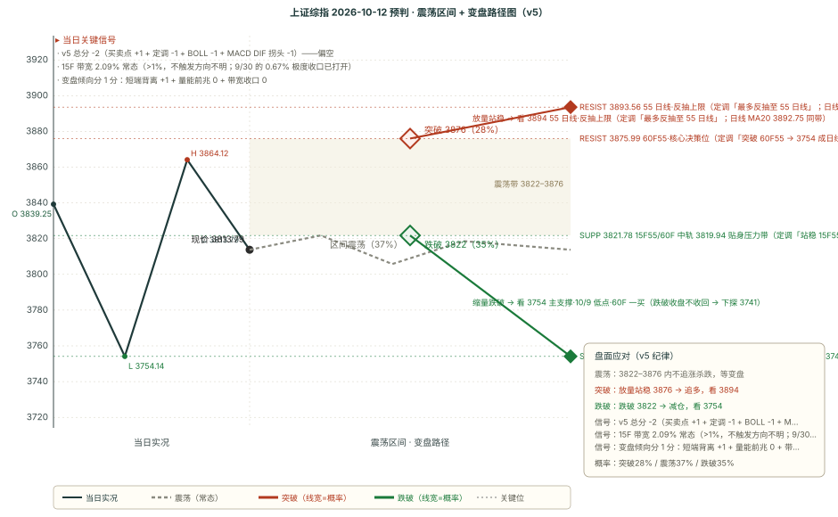

# 作战报告 · 晨报 · 2026-10-12（周一）

> 档位：晨报（morning）｜资讯窗口：2026-09-30 15:00 ~ 2026-10-12 08:30（**跨国庆假期补抓，28 条**）｜数据时点：10-12 09:15
>
> 现价基准 = 10/9 收盘 **3813.79**（+0.05%）；O 3804.09 / H 3824.71 / L 3754.14（长下影下探回升）
>
> 上一档（9/30-morning）目标日为 9/30；其后 10/1-10/7 国庆休市、**10/8、10/9 两个交易日未跑晨报**，本档补做 9/30-morning 的**跨假期复盘**（详见第四块）
>
> ⚠️ **本档最关键的变化（一句话）**：**节后向下破位**——10/9 最低逼近 3741 目标，9/30 晨报「变盘预警 + 变盘分 3/3」最终**向下兑现**；本期判 **偏空 -2**（15F 带宽已从 0.67% 打开到 2.09%，不再触发「方向不明」），但 60F 一买 + 短端 DIF 三级别向上 = 短线超跌反抽，需突破 60F55 决策位（见第四块关键位表）才能确认。
>
> 🔁 **本档口径提示**：10/9 收盘为本档最新已收盘基准；四因子输入全部更新到 10/9 收盘根，非冻结。

---

## 核心主线速览（三行）

1. **节后向下破位、逼近 3741**——10/8 破 9/28 前低 3806.67、10/9 再创新低后长下影回升，9/30「变盘预警」向下兑现。
2. **60F 一买 + 短端 DIF 三级别向上**——短线超跌反抽信号，但定调明确「突破 60F55 则 3754 成日线拐点，否则 3754 难保」。
3. **定调「60F 底背离雏形」vs 游资「没见底、跌速放缓」**；海外 AI 硬件链（CPO/三星/Marvell）继续向上；剧本 A35/B37/C28。

---

## 第一块 资讯信息（晨报 · 28 条窗口内）

> 本期窗口 28 条内容（跨国庆假期补抓），说明见文末附录
> 本块只做「事实落地」，结论层推导统一放第二块与第四块

### 一、核心主线（按强度排序）

#### 1. 定调（10/11 22:24 · 本档方向因子核心，原文已归档）

- **原文（一字不差，全文见归档）**：「周五市场下探回升，留下一根长下影线，反弹至 15F55 线/60F 中轨位置。从日线级别上看，直接突破 55 日线且新高 3995 难如登天，最多是反抽至 55 日线后，以 3995 以来日线第五段下跌新低 3741。从 60F 级别看，已经完成三段下跌 + 月线中轨附近的底背离雏形，如果突破 60F55 线，可以把 3754 作为日线拐点，看看能不能反弹至 55 日线；但如果无法突破 60F55 线，则 3754 很难保住，明天短线就看能否顺利站稳 15F55 线/60F 中轨，以及对于 60F55 线如何挑战，否则也就别谈什么反弹了。」
- **三条实战结论**：① 「**日线直接突破 55 日线 + 新高 3995 难如登天，最多反抽 55 日线后走 3995 以来日线第五段下跌新低 3741**」——中期下跌未结束；② 「**60F 已完成三段下跌 + 月线中轨底背离雏形，突破 60F55 则 3754 成日线拐点**」——短线反抽有条件；③ 「**明天短线看能否站稳 15F55 线/中轨、如何挑战 60F55，否则别谈反弹**」——两个决策位清晰。
- **与 9/30 定调的关系**：从「明天博弈 60F 升级」推进到「60F 底背离雏形已现、3754 成日线拐点候选」，并明确「3741 新低」为日线第五段下跌目标；中期（日线）下跌中继的判断不变。

#### 2. 游资「指数没见底 + 跌速放缓 + 无大催化、题材投机轮动」（10/11 晚 + 10/12 盘前）

- **10/11 晚信息汇总**：「周末没啥大催化的消息；游资小睿睿发文说没见底，我比较赞同，它说弱势行情的玩法，聚焦各个题材一两个活口核心标就好，后排不做，没大催化之前都是这个玩法；每种模式都尽量只做领头的，后排全放弃。题材预计小题材投机为主：AI 应用（短剧）、AI 医药、消费活口、厄尔尼诺（粮食）电网、煤炭、固态、化工涨价里轮；券商看平台（9.30 新规后找大 V 打广告不行了，平台受益）。」
- **10/12 早盘前热榜**：「周末各种消息和昨晚差不多，大催化的东西没有；周五村里出手 V 起来后，这个位置跌速应该会放缓，甚至不排除继续回抽一下均线；虽然很多人都认为指数还没见底，但这周应该会比之前好那么一点；题材偏投机轮动（AI 安全、短剧、医药、煤炭、化工涨价、固态），价投逻辑线目前没明确题材。」
- **口径**：指数没见底但短线跌速放缓、或回抽均线；无大催化、题材投机轮动、超短只看领头。

#### 3. 海外 AI 硬件链（10/11 密集）：CPO 预期重置 + 三星 3Q + Marvell 上调 + AAOI 激光器

- **大摩（CPO）**：「台湾 CPO 供应链回调后预期已重置，是重新审视相关标的的时候，重申 ASE 增持、WIN Semi 上调至 Equal-weight」。
- **野村（三星）**：「三星电子 3Q26 营业利润 107 万亿韩元基本符合预期，受韩元兑美元升值约 7% 影响略低，维持买入、目标价 67 万韩元」。
- **大摩（Marvell）**：「2026 投资者日后长期模型指向 2030 年 EPS 超 30 美元，目标价从 305 上调至 360 美元」。
- **白毛日报（AAOI）**：「AAOI 激光器护城河、2027 年爬坡被低估」。
- **大摩（苹果）**：「已开始削减 iPhone 18 零部件订单（供应链渠道验证初期需求疲软），终端组装与晶圆订单暂未变动」。
- **定性**：美股 AI 硬件算力链（CPO/存储/激光器）产业逻辑持续向上，与国内磨底形成「外强内弱」背离。

#### 4. 宏观/估值（DRAGON BALL 10/11 19:51 + 21:07）

- **19:51（美股科技估值）**：「美股科技 9 月见顶了吗？eps 没下修却走成这样说明估值在下修，要找原因就得找为什么估值会下修；映射美股的出发点就是错的，牛市估值扩张的时候可以映射，熊市就纯靠 eps 增速比估值收缩速度快了」。
- **21:07（利率）**：「利率是结果而不是原因，等利率下来可能代表经济出问题了；钱能出得去、能配置美债肯定是非常好的选择；利率下来之后偿债压力会更大（税基变小、需要更多苛捐杂税来扩大税基）」。
- **卫斯李 10/11 20:46 宏观图表**：「中国制造业工资增速已放缓至约 1%（低于服务业约 4%），服务业占 GDP 57.7%，约一半贷款实际利率低于 LPR」。
- **定性**：宏观层面对 A 股「估值下修 + 收入约束」的中期压制仍在。

---

## 第二块 信息判断（多方观点对比 + 共识复盘）

### 一、多方观点对比

#### 共同观点（结论式，细节见第一块）

1. **中期方向偏空、指数没见底仍是多方一致的底色**——定调（日线难如登天、3741 新低）与游资（小睿睿「没见底」、大鹏鸟「我比较赞同」）同向；无任何一方给出「指数级反弹 / 普涨」的口径。
2. **短线反抽有限、聚焦题材活口**——游资「弱势行情聚焦题材一两个活口核心标、后排不做」；定调「反抽需站稳 15F55 线/中轨、挑战 60F55」；无大催化、价投逻辑线无明确题材。
3. **海外 AI 硬件链「产业长期紧缺、盘面短期磨底」背离延续**——海外投研侧（CPO/三星/Marvell/AAOI）继续加码，国内游资侧（没见底、题材投机）明确谨慎。

#### 相反观点

**① 「短线超跌反抽（60F 一买 + 底背离雏形 + 长下影承接 + 短端 DIF 三级别向上 + 跌速放缓）」 vs 「中期下跌中继（日线难如登天 + 3741 新低 + 三级别 BOLL 看空 + 日线 DIF 加速）」**

- **看短线超跌反抽侧**：定调「60F 三段下跌 + 月线中轨底背离雏形、突破 60F55 则 3754 成日线拐点」；引擎B 60F 一买（见第三块缠论表）；MACD 15F/30F/60F/120F DIF 四级别向上；10/9 长下影下探回升（主支撑位已有一次承接）；游资「村里出手 V 起来、跌速放缓、可能回抽均线」。
- **看中期下跌中继侧**：定调「日线直接突破 55 日线 + 新高 3995 难如登天、最终 3741 新低」；BOLL 三级别看空（60F 72%/120F 88%/日线 81%）；日线 DIF -22.23→-25.29 加速下杀、日线中枢下沿 3842.72 已破 28.93 点；游资「指数没见底」。
- **判定：未决，方向倾向中期偏空（v5 -2）。** 短线超跌反抽与中期下跌中继并存，是本档核心张力，且是 9/30「变盘预警」向下兑现后的再平衡。**操作统一**：反抽贴身压力带（见第四块关键位表）默认遇阻（不追多）；「放量 + 收盘站稳 60F55 决策位 + 日线 DIF 拒绝下杀」三证齐全才升级为反抽剧本 C；破主支撑收盘不收回则下探 3741。**分界指标**：① 今日能否站稳短线第一确认位（3820 一线）；② 反抽高度与量能（能否放量挑战 60F55）；③ 日线 DIF 今日读数（继续加速 → 中期下跌主导，收敛 → 反抽有据）；④ 主支撑是否被测试。

#### 隐含共识

**所有信息都不指向指数级崩跌或普涨，全部落在「中期下跌中继（定调 + 游资）+ 短线超跌反抽（定调 + 技术）+ 无大催化题材投机（游资）+ 海外 AI 硬件外强内弱（投研）」四个变量上**——与技术面「偏空 -2 + 短线超跌反抽」互为印证：**指数弱势、胜负在短线超跌反抽能否突破 60F55 确认，还是继续下探 3741**。

#### 独立视角

- **定调是本轮唯一给出「反抽路径 + 两个决策位」的体系**：15F55/60F 中轨（短线第一确认）/ 60F55（3754 转日线拐点）/ 55 日线（反抽上限），且明确「直接突破 55 日线 + 新高 3995 难如登天」——第四块的剧本触发条件直接建立在该框架上。
- **海外 AI 硬件链**是唯一与「产业逻辑」直接挂钩的增量线索——它不改变 A 股中期方向，但为节后「题材投机（AI 安全/短剧）」提供产业背书（外强内弱背离延续）。

### 二、上期共识复盘（9/30-morning 共识链 · 跨假期）

> 9/30-morning 共识（5 条共识 + 2 组对立）目标日为 9/30，其后跨国庆假期 + 节后 10/8、10/9 未跑，本档补做跨假期复盘。**关键兑现**：① 定调「日/周下跌中继、明天博弈 60F 升级」——**⚠️ 部分**（9/30 当天 +0.30% 微涨收阳、盘中高 3851.22 略破 3842.72 但未站稳，符合「分钟级反抽空间不大」；节后 10/8、10/9 向下破位，「下跌中继」兑现）；② 游资「美债新高、宏观偏压制、轻仓过节」——**✅ 兑现**（节后 10/8 -0.79%、10/9 再创新低，宏观压制兑现）；③ 地产利好「托底非强刺激」——**✅ 兑现**（节后地产未延续领涨，10/9 房地产 -0.24% 转弱）；④ 海外 AI 硬件「产业长期紧缺」——**⏳ 跟踪中**（10/11 大摩 CPO/三星/Marvell 继续加码，产业逻辑延续）；⑤ AI 硬件链「OpenAI/Anthropic/OCS」——**⏳ 跟踪中**（无当日裁决）。两组对立观点均「未决」状态跨期，细节见 chain_apply 落盘。

### 三、本期新共识（已追加 consensus_chain，避免重复不展开）

本期新增 4 条（2 条 short + 2 条 mid）与 1 组相反观点：定调「60F 底背离雏形、突破 60F55 则 3754 成日线拐点」/ 游资「没见底 + 跌速放缓 + 题材投机轮动」/ 海外 AI 硬件链「CPO/三星/Marvell/AAOI」/ 宏观估值「利率是结果 + 估值下修」。细节见第一块，此处不重复。

---

## 第三块 技术分析（缠论买卖点 + BOLL + 关键均线）

> 现价基准 = 10/9 收盘 **3813.79**（+0.05%）；OHLC 详见本报告头

### 引擎 B：chan-signal 缠论买卖点（五周期）

| 周期 | 趋势 | 买卖点 | 中枢 | 位置 |
|---|---|---|---|---|
| **日线** | 向下 | 一卖 @3967.68（conf **0.8**） | 3884.44-3842.72 | 中枢下方（**已跌破下沿 28.93 点，向下破坏持续**） |
| **周线** | 向下 | 一卖 @3995.18（conf 0.5） | 4034.08-3927.85 | 中枢下方 |
| **60F** | 向下 | **一买 @3754.14（conf 0.5）** | 3896.26-3852.03 | 中枢下方，**10/9 最低点形成，现价 +59.65 点** |
| **15F** | **向上** | 无信号 | 无中枢 | — |
| **5F** | 向上 | 无信号 | 无中枢 | — |

**定性**：五周期「日线（中枢下破）+ 周/60F 向下 + **15F/5F 向上**」——**60F 一买（10/9 最低点，较 9/30 的 3806.67 下移）是本轮短线反抽信号**，但日线中枢向下破坏 + 周线/日线一卖在上方压制，中长期结构未修复。日线一卖/周线一卖按规则不进方向分（仅作点位锚）。

### 关键均线与 MACD（多级别 55 线体系 + 级别分裂）

| 周期 | MA20 | MA55 | DIF | 前值 | DIF 方向 | 区域 |
|------|------|------|-----|------|---------|------|
| 日线 | 3892.75 | 3893.56 | **-25.29** | -22.23 | **向下** | 空头区（死叉加深） |
| 120F（合成） | 3874.63 | 3907.47 | -29.78 | -30.02 | **向上** | 空头区 |
| 60F | 3819.94 | 3875.99 | -24.69 | -26.79 | **向上** | 空头区 |
| 30F | 3815.31 | 3848.62 | -12.49 | -14.45 | **向上** | 多头区 |
| 15F | 3794.03 | 3821.78 | -1.29 | -2.36 | **向上** | 多头区 |
| 5F | 3813.05 | 3793.76 | 7.66 | 8.45 | 向下 | 空头区 |

> 注：表中 **MA20** 即各周期 BOLL 中轨（**BOLL 中轨 ≡ MA20**，数学恒等），下文「中轨」均指 MA20。

**级别结构**：**长端日线 DIF 继续向下（-22.23→-25.29），短/中端 4 级别（60F/30F/15F/120F）DIF 拐头向上**——短长端背离以「长端日线补跌 + 短端四级别反抽」的方式并存，60F DIF 拐头向上（-26.79→-24.69）正是定调「60F 三段下跌 + 月线中轨底背离雏形」的技术镜像。

**关键轨道（四级中轨，由高到低）**：日线 3892.75 / 120F 3874.63 / 60F 3819.94 / 15F 3794.03——**现价 3813.79 在 15F 中轨上方、其余中轨下方**。

### BOLL（boll_chan 四级别）

| 周期 | 概率 | 定性 | 带宽 | 状态 | 路径 |
|---|---|---|---|---|---|
| 15F | 涨 **54%** / 跌 46% | 中性 | 2.09% | 常态 | 趋势向上，回踩 3794.03 中轨是买点 |
| 60F | 涨 28% / 跌 **72%** | 看空 | 2.36% | 常态 | 趋势向下，反弹 3819.94 中轨是卖点 |
| 120F | 涨 12% / 跌 **88%** | 看空 | 5.99% | 开口向下 | 中轨下行，反弹 3874.63 遇阻则回落 |
| 日线 | 涨 19% / 跌 **81%** | 看空 | 4.86% | 开口向下 | 趋势向下，反弹 3892.75 中轨是卖点 |

**定性**：**BOLL 体系三级别（60F/120F/日线）看空 + 一级别（15F）转中性**——9/30 的「15F 翻多看多 82% + 极度收口」本期收敛为「15F 中性 54% + 带宽打开」，短线反抽动能较 9/30 减弱但结构未坏。**共振读数**：60F 一买 3754.14 与 60F 下轨 3774.86 距 0.54%（一买在跌破下轨后形成，弱共振）；日线一卖 3967.68 与日线上轨 3987.33 距 0.50%（弱共振）。

---

## 第四块 预判（技术预判与复盘）

### 一、上期复盘（9/30-morning · 跨假期）

> 9/30-morning 预判目标日为 9/30；其后 10/1-10/7 国庆休市、10/8、10/9 未跑，本档补做跨假期复盘（以 9/30 当天 + 节后 10/8、10/9 实际为裁决依据）。

| 维度 | 判定 | 说明 |
|---|---|---|
| 方向 | ⚠️ 部分 | 判「方向不明（偏空 -2 + 带宽收口）」。9/30 当天 +0.30% 微涨收阳（方向标签当天未兑现，但「方向不明」本就不押当天方向）；**节后 10/8 -0.79%、10/9 最低 3754.14 向下破位，「变盘在即 + 偏空倾向」向下兑现** |
| 区间 | ❌ 失守 | 核心 3807-3843：9/30 当天高 3851.22 破上沿 8.22 点、节后 10/8 低 3795.37 破下沿，「变盘在即」预警的收口变盘兑现为双向破位 |
| 支撑 | ❌ 失守 | 主支撑 3806.67（9/28 新低·60F 一买）10/8 被破（最低 3795.37）、10/9 再破（续创新低） |
| 压力 | ✅ 守住 | 主压力 3842.72（旧前低·中枢下沿）9/30 盘中上穿 8.5 点、收盘 3842.19 未站稳，「放量 + 收盘站稳才升级反抽」判定精准，节后回落验证 |

**复盘三问（OBS 自检）**：① OBS-1 否；② OBS-2 **命中**——9/30「变盘倾向分 3/3 满分（首次）」最终向下变盘兑现，是变盘分满分首次命中「变盘」的样本；③ OBS-3 否（带宽收口触发的「方向不明」，最终向下变盘，属「收口 → 方向选择」的正常路径）；④ OBS-4 不新增（仍跟踪）。

### 二、偏差观察统计表（59 期 · v5 配对计数 · 截止 2026-10-12）

> 上期 9/30 报告为 58 期，本期补做 9/30-morning 跨假期复盘后计 59 期（具体四维计数以 chain_apply 落盘 + bias_stats 校验为准）。

| 维度 | 趋势 | 说明 |
|------|------|------|
| 方向 | 结构未变 | 方向维「部分」占比最高，仍是四维中最弱项 |
| 区间 | 结构未变 | 区间维持续垫底，「方向对、幅度差一点」 |
| 支撑 | 结构未变 | 支撑维命中率最高，但本期 9/30 支撑失守（10/8 破 3806.67） |
| 压力 | 结构未变 | 压力维「收盘站稳才确认」口径持续有效 |

**结构未变**：支撑 > 压力 > 方向 > 区间。**继续观察、不修改规则**（引擎参数不动；OBS-4 候选累计不足，未提请拍板）。

### 三、本期预判（10/12 全天）

#### 一句话预判

> **偏空（-2，15F 带宽 2.09% 已打开），核心带 3754-3822**。60F 一买@3754 + 短端 DIF 三级别向上，短线超跌反抽；但日线难如登天、3741 新低风险、三级别 BOLL 看空，中期下跌。反抽 3820 遇阻回落，站稳 60F55 才升级。A35/B37/C28。

#### 完整预判字段

| 字段 | 内容 |
|---|---|
| **方向** | **偏空**（v5 总分 **-2**：买卖点 **+1** + 定调 **-1** + BOLL **-1** + MACD DIF 拐头 **-1**；15F 带宽 2.09% > 1%，不触发「方向不明」） |
| **区间** | 3754-3822（核心 68 点）/ 3741-3876（扩展 135 点） |
| **支撑/压力** | **见下方「关键位相对现价」表（唯一落地处）**——主支撑 = 10/9 低点·60F 一买；主压力 = 15F55（见关键位表） |
| **置信度** | **中**——方向偏空 -2 明确，但「60F 一买 + 短端 DIF 三级别向上」的短线反抽信号同样明确，路径存双向 |

#### v5 打分明细

- **买卖点因子（+1）**：60F 一买@3754.14（10/9 最低点形成，下跌背驰反转·左侧建仓；9/30 的 60F 一买@3806.67 已被 10/8-10/9 跌破而失效）→ **+1**；日线一卖/周线一卖按规则不进方向分。
- **定调因子（-1）**：10/11 22:24 定调「日线直接突破 55 日线 + 新高 3995 难如登天、最终 3741 新低；60F 底背离雏形但需突破 60F55 确认」→ 中期偏空不变 → **-1**。
- **BOLL 变盘因子（-1）**：60F 涨 28%/跌 72%（偏离 22pct）、日线涨 19%/跌 81%（偏离 31pct）双双越 15pct 且同向偏空 → **-1**（15F 中性 54% 但 BOLL 因子按 v5 只取 60F/日线）。
- **MACD DIF 拐头因子（-1）**：日线 DIF **-22.23 → -25.29**（单日 -3.06，死叉加深、加速下行），DEA -14.14，空头区 → **-1**。
- **总分：+1 -1 -1 -1 = -2 → 偏空**（≤-2，且 15F 带宽 2.09% > 1% 不触发「方向不明」）

> ⚠️ **附注一（与 9/30-morning 的关系）**：总分同为 -2，但性质变了——9/30 是「方向不明（-2 + 带宽收口拦下）」，本档是「明确偏空（-2 + 带宽已打开）」，变盘倾向分从 3/3 满分回落到 1/3。
> ⚠️ **附注二（OBS-2 变盘倾向分）**：本档剧本概率由 OBS-2 映射产出（calc_turn_score.py），**变盘倾向分 = 1/3**：① 短端背离 **+1**（15F/30F/60F DIF 向上 3/3 且日线偏空）；② 量能前兆 **0**（10/9 量能 5.35 亿手为近 5 日最高、放量非缩量新低，且未站上关键位）；③ 带宽收口 **0**（15F 带宽 2.09% > 1%）。映射 A/B/C = 40/35/25 → 1 分「A−5/B+2/C+3」→ **35/37/28**。
> ⚠️ **附注三（量能口径）**：量能前兆按「近 5 日窗口（含当日）」判（VOL_NEWLOW_DAYS=5）；10/9 量能 5.3515 亿手，近 5 日（9/28~10/9）最大值，故「缩量至 5 日新低」不命中（节后放量承接，非缩量衰竭）。

#### 剧本概率与触发条件

| 剧本 | 概率 | 触发条件 | 路径 |
|------|------|---------|------|
| **A 延续偏空** | **35%** | 反抽贴身压力带遇阻（量能不放大）→ 破主支撑收盘不收回 | 压力带 → **主支撑** 遇阻回落 → 破主支撑 → **3741** |
| **B 弱势震荡磨底** | **37%（名义最高）** | 节后交投未恢复 + 短线超卖企稳，核心带内窄幅拉锯 | 核心带内反复；题材投机（AI 安全/短剧/医药）活跃 |
| **C 反向反抽升级** | **28%** | 放量（>5.35 亿手）突破 60F55 决策位且收盘站稳 + 日线 DIF 拒绝下杀 | 决策位 → 3892.75-3893.56（日线 MA20 + 55 日线） |

> **下方支撑**：主支撑（-1.56%）是「60F 一买」短线企稳位，破位须以收盘确认；一旦失守，3741 是最近结构目标（无中间缓冲）。**上方逐级反压**：贴身压力带（第一道，15F55/60F 中轨）→ 60F55 决策位（定调「突破则 3754 成日线拐点」）→ 3892.75-3893.56（日线 MA20 + 55 日线）。

#### 纪律与观察

**纪律（6 条）**

1. **贴身压力带（15F55/60F 中轨）= 今日短线多空分界**——两线密集；反抽至此默认按遇阻对待（v5 逆势反抽纪律 + BOLL 60F「反弹中轨是卖点」）；「站稳 15F55/60F 中轨」是定调点名的短线第一确认。
2. **3875.99（60F55）= 中期决策位、反抽升级唯一确认条件**——「放量 + 收盘站稳 60F55」→ 3754 转日线拐点、反抽至 55 日线；否则 3754 难保。
3. **3754.14（10/9 低点·60F 一买）= 主支撑、短线生死线**——跌破收盘不收回则下探 3741（无中间缓冲）。
4. **不因短端 DIF 三级别向上追多**——短端反抽是「60F 底背离雏形」而非「趋势反转」，须「日线 DIF 拒绝下杀 + 收复 60F55 + 放量」三证；否则反抽只是下跌中继的分钟级反弹（定调「最多反抽 55 日线后走 3741 新低」）。
5. **游资口径「指数没见底」+ 无大催化**——价投逻辑线无明确题材，超短只看领头、后排不做（题材轮动：AI 安全/短剧/医药/煤炭/化工涨价/固态）。
6. **OBS-2 教训记取**——名义最高 B 37% 不构成承诺，操作以触发条件而非概率排序决策（3820 得失 → 短线反抽能否延续；决策位得失 → 3754 转拐点还是继续下探 3741）。

**开盘后重点观察（5 项）**

1. **今日能否站稳 15F55/60F 中轨（3820 一线）**——定调短线第一确认，站稳则反抽延续、否则回落。
2. **反抽高度与量能**——反抽至 3820 是否放量；缩量反抽=遇阻信号；能否放量挑战 60F55 决策位是关键。
3. **决策位得失**——60F55 决策位，放量收盘站稳才升级反抽剧本 C（3754 转日线拐点）。
4. **主支撑是否被测试**——主支撑·60F 一买位，收盘跌破不收回则下探 3741。
5. **日线 DIF 今日读数**——继续加速下行 → 剧本 A；跌速收敛 → 剧本 B/C。

#### 关键位相对现价（现价 3813.79）

| 关键位 | 价格 | 相对现价 | 属性 | 依据 |
|---|---|---|---|---|
| 日线一卖 | 3967.68 | +4.03% | 压力（上行天花板） | 日线一卖 conf0.8 + 9/22 高 |
| 55 日线 / 日线 MA20 | 3893.56 / 3892.75 | +2.09% | 压力 | 定调「反抽至 55 日线」上限 |
| **60F55** | **3875.99** | **+1.63%** | **压力（决策位）** | 定调「突破 60F55 → 3754 成日线拐点」 |
| 30F55 | 3848.62 | +0.91% | 压力 | 30F 均线 |
| **15F55** | **3821.78** | **+0.21%** | **压力（主压力·贴身）** | 定调「站稳 15F55 线」 |
| 60F 中轨 | 3819.94 | +0.16% | 压力（贴身） | 定调「站稳 60F 中轨」 |
| **现价** | **3813.79** | **0.00%** | **现价（分界）** | 10/9 收盘 |
| 15F 中轨 | 3794.03 | -0.52% | 支撑 | BOLL 15F「回踩中轨是买点」 |
| 10/8 低点 | 3795.37 | -0.48% | 支撑 | 节后首日低点 |
| **10/9 低点·60F 一买** | **3754.14** | **-1.56%** | **支撑（主支撑）** | 前低 + 60F 一买（下跌背驰反转点） |
| 日线第五段下跌目标 | 3741 | -1.91% | 支撑（最低） | 定调「3995 以来日线第五段下跌新低 3741」 |

---

## 第五块 行业强弱榜（申万一级 · 10/9 收盘）

> 数据时点：10/9 收盘（申万一级行业，akshare 实时榜 + 同花顺缠论方向分已修复刷新）

### 一、数据层

#### 1. 涨跌幅（申万一级 · 10/9 收盘）

**领涨 TOP5**：传媒 +5.29% ｜ 计算机 +2.33% ｜ 商贸零售 +2.30% ｜ 有色金属 +2.17% ｜ 纺织服饰 +1.92%

**领跌 TOP5**：国防军工 -1.70% ｜ 电子 -1.47% ｜ 银行 -1.07% ｜ 机械设备 -0.98% ｜ 建筑材料 -0.88%

**风格定性：10/9 是「题材成长超跌反弹 + 权重/军工回落」的一天。** 传媒 +5.29%（短剧）、计算机 +2.33%（AI）领涨，与游资「题材投机轮动（AI 安全/短剧/医药）」呼应；银行 -1.07%、国防军工 -1.70% 领跌，权重与军工回落。这与 10/9 长下影下探回升的「超跌反弹」性质一致。

#### 2. 缠论方向分（申万一级归组 · 同花顺 10/12 已刷新）

> 同花顺数据源 HTTP→HTTPS 修复后，缠论方向分本轮**用 10/9 收盘刷新值**（非沿用）。

- **做多侧**：房地产 +2.0 ｜ 银行 +2.0 ｜ 食品饮料 +1.3 ｜ 医药生物 +1.2 ｜ 美容护理 +1.0
- **做空侧**：国防军工 -4.0 ｜ 有色金属 -3.8 ｜ 通信 -3.5 ｜ 机械设备 -3.2 ｜ 计算机 -3.0 ｜ 电子 -2.7

### 二、推导层（三要素）

#### 规避榜 TOP3（基于 10/9 涨跌幅 + 缠论方向分）

| 行业 | 涨跌幅 | 缠论方向分 | 定性 | 置信度 |
|------|-----------|---------|---------|--------|
| **国防军工** | **-1.70%（领跌）** | **-4.0（做空最强）** | 涨跌 + 方向分双杀，节后资金持续撤离 | **中-高** |
| **电子** | **-1.47%** | **-2.7** | 涨跌 + 方向分双杀，半导体磨底 | **中** |
| **计算机** | **+2.33%（领涨）** | **-3.0** | 涨跌幅与方向分背离（超跌反弹 vs 趋势做空） | **中** |

- **国防军工（-1.70% / 方向分 -4.0）**：涨跌幅领跌 + 缠论方向分做空最强，双杀，节后无承接。
- **电子（-1.47% / 方向分 -2.7）**：半导体磨底，涨跌 + 方向分双弱。
- **计算机（+2.33% / 方向分 -3.0）**：领涨但方向分做空，属「超跌反弹 vs 趋势做空」背离——反弹持续性存疑，不追高。

#### 反抽观察（非规避，超跌反弹性质）

- **传媒（+5.29%，领涨）**：短剧题材驱动，游资点名「AI 安全/短剧」投机方向，但无大催化，属题材投机轮动、非趋势反转。
- **有色金属（+2.17%）/ 纺织服饰（+1.92%）**：超跌反弹，节后无持续催化。

#### 共振/背离说明

- **传媒「涨跌幅 +5.29% vs 方向分 -0.7」背离（关键）**：短剧题材驱动领涨，但缠论方向分转向上（-0.7 趋势向上）——题材投机与缠论趋势方向不一致，反映「超跌反弹」性质、非「趋势反转」。
- **银行「涨跌幅 -1.07% vs 方向分 +2.0」背离**：权重回落但缠论方向分做多（防御资金结构），与「权重领跌、题材反弹」的风格切换一致。
- **宽基与量能**：10/9 量能 5.35 亿手（放量承接）下，题材成长反弹 + 权重军工回落——与「长下影下探回升的放量承接」性质一致。

---

## 附录 抓取通道信息

**抓取窗口**：2026-09-30 15:00 ~ 2026-10-12 08:30（跨国庆假期补抓断层）

| 通道 | 工具 | 本期条数 | 备注 |
|---|---|---|---|
| 通道 A（Skill/zsxq-cli） | `zsxq-cli` | **19** | 卫斯李 1 + 基业长青 15 + 定调 3 |
| 通道 B（Cookie 直连） | api.zsxq.com | **9** | 大鹏鸟 2 + 短评&信息 0 + 180K 3 + AI 产业链 4 |
| **合计** | | **28** | **图片 24 张 / 附件 73 个** |

**数据完整性说明**：

- ✅ **两条通道均正常**：Skill 通道 19 条 + Cookie 通道 9 条，均成功；Cookie 有效（`degraded` 为空，大鹏鸟限流抖动 1 次后自愈）。
- ✅ **定调 1 条原文已一字不差归档**（`outputs/DRAGON_BALL_原始记录_2026-10-12.md`）。
- ✅ **同花顺行业数据源已修复**（HTTP→HTTPS 重定向）——第五块缠论方向分用 10/9 收盘刷新值，不再沿用 9/24。
- 凭证文件路径 `.workbuddy/zsxq_cookie.txt`（不入 git，**严禁跨机拷贝**）。

---

## 产物清单

| 路径 | 类型 | 说明 |
|---|---|---|
| `outputs/作战报告_晨报_2026-10-12.md` | Markdown 报告 | 本文件（五块齐全 + 附录 + 产物清单） |
| `outputs/作战报告_晨报_2026-10-12.html` | HTML 报告 | 浏览器预览版 |
| `outputs/000001_forecast_2026-10-12.svg` | SVG 走势图 | 10/12 全天预判条件触发决策路径图 |
| `outputs/DRAGON_BALL_原始记录_2026-10-12.md` | 原文归档 | 定调 1 条一字不差归档 |
| `.workbuddy/zsxq_fetch_raw.json` | 原始数据 | 28 条窗口内资讯内容 |
| `.workbuddy/forecast_chain.json` | 预判链 | **60 条（59 verified + 1 pending：10/12-morning）** |
| `.workbuddy/consensus_chain.json` | 共识链 | **29 条（28 verified + 1 pending：10/12-morning）** |

**本期待办（交接给下一档）**：

1. **10/12 收盘档复盘 10/12-morning 两条 pending**（forecast 与 consensus 均 target 10/12）——重点核验：① 定调「站稳 15F55/中轨、突破 60F55」是否兑现；② 60F55 决策位与主支撑两个关键位的得失；③ 剧本 A/B/C 实际落点（OBS-2 累计样本）；④ 3741 目标是否被测试。
2. **OBS-4 候选跟踪**——「定性信号强度被等权低估」持续跟踪，待同机制 ≥3 次再提请拍板。
3. **开盘后跑 gap 校准**（可选，9:25 后秒级）——`run_morning_report.py gap`，确认 gap 方向 vs 偏空方向的一致性。
4. **10/8、10/9 未跑晨报的断层**——预判链在 9/30 之后、10/12 之前缺 2 个交易日记录，已在本档「跨假期复盘」中一次性承接，无需补造历史记录（链 append-only）。
