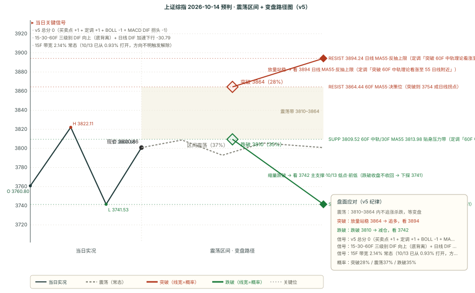

# 作战报告 · 晨报 · 2026-10-14（周三）

> 档位：晨报（morning）｜资讯窗口：2026-10-13 16:00 ~ 10-14 08:30（34 条）｜数据时点：10-14 08:57
> 本档手动触发（08:57 落链）；本期 target 10/14 全天，10/13-close 两条 pending 目标日 10/14 尚未走完、省略复盘（延至收盘档）

---

## 核心主线速览（三行）

1. **上证 10/13 低开下探 3741 精准触及定调目标后 V 反收 3800.86（+0.10%）**；15-30-60F 三级别底背离成形。
2. **定调 10/13 22:09「是该反弹的」但「左底可能性大、机构向下」**；60F 中轨 3809.52 成明日必争压力位。
3. **本期维持「震荡（v5 总分 0）」**：核心带 3741-3810，剧本 A35/B37/C28。

---

## 第一块 资讯信息（跨夜快报 · 34 条窗口内）

> 本块只做「事实落地」，结论层推导统一放第二块与第四块。本期跨夜窗口 34 条（Skill 通道正常；Cookie 通道鉴权失败 4 星球降级）。

### 一、核心主线（按强度排序）

#### 1. 定调（10/13 22:09 · 本档方向因子核心，原文已归档）

- **原文（一字不差，全文见归档）**：「今天市场剧烈震荡，新低3756后引发反弹，沪指15-30-60F均出现底背离，且接近双日级别233线，所以是该反弹的，反弹至60F中轨受到压制。……明天如果反弹要延续，那么60F中轨仍然是绕不开必须要挑战的压力位。如果顺利突破60F中轨，则理论上看涨至55日线附近，但今天没有新低3741.11把结构做完整，也确实为后续埋下了隐患，突破55日线的概率很低。如果要突破60F中轨，要么借助30F极强，要么借助120F金叉下的5F主涨段，如果明天5F55线持续支撑，那么突破的概率是比较大的。整体来说这里我很难认为是一个尖底，左底的可能性更大……机构方向既没有波动率，趋势还是向下。」
- **三条实战结论**：① 「**15-30-60F 均底背离 + 接近双日 233 线 → 该反弹**」——短线反抽原料齐备；② 「**60F 中轨 3809.52 是绕不开的压力位**」——明日多空分界；③ 「**很难是尖底、左底可能性更大**」+「**机构趋势向下**」——反弹性质是左底，非反转。

#### 2. AI 硬件上游景气（基业长青 31 条主线）

- **PCB 产业链业绩确定性**：华正新材（PCB 业绩确定）、兴森科技（Q3 已收 ins3 批量订单、光模块系统级测试年底交付）、鸿富诚（募资 7.7→12.2 亿、投产快于预期）、联动科技（功率测试设备龙头，进军 SoC/存储测试）。
- **CPO 光电测试**：TrendForce「光电测试平台成 CPO 量产关键，测试设备供应链版图迎新变局」。
- **存储/半导体**：长鑫存储消息扰动北亚科技；摩根大通半导体 Q3 前瞻「供应约束、AI 动能及周期性复苏支撑业绩」。
- **AI 模型**：一线开发反馈 Opus 5.5 非常聪明、断档式领先。

#### 3. 海外投研（卫斯李 + 基业长青）

- **高盛中国 wrap**（早 08:31）：宏观数据成今日核心焦点，中国 9 月通胀数据出炉。
- **伯恩斯坦美国 IT 硬件**：戴尔（DELL）三大担忧及风险可控论证。
- **美银互联网路演**：互联网板块情绪修复面临逆风。
- **美股/港股**：标普 500 收 7805（-0.02%）震荡；港股恒生 +0.3%、恒生科指分化。

---

## 第二块 信息判断（多方观点对比 + 本期新共识）

### 一、多方观点对比

#### 共同观点（结论式，细节见第一块）

1. **短线反抽有原料、中期下跌未结束**——定调「15-30-60F 底背离 → 该反弹」与「左底可能性大、机构向下」并存，多空双方都承认反抽有限、非趋势反转。
2. **60F 中轨 3809.52 是短线多空分界**——定调「绕不开的压力位」，突破看涨 55 日线、遇阻则回落，与技术面「60F 中轨压制」重合。
3. **AI 硬件上游景气向上**——PCB/CPO/存储/测试设备（华正/兴森/联动/TrendForce/摩根大通）均指向景气，与盘面短期磨底形成背离。

#### 相反观点

**① 「短线反抽（15-30-60F 底背离 + 该反弹 + 5F55 支撑）」 vs 「中期下跌中继（左底 + 机构向下 + 日线 DIF 加速）」**

- **看短线反抽侧**：15-30-60F 三级别 DIF 全部向上（底背离成形）+ 接近双日 233 线 + 定调「是该反弹的」+ 60F 一买强共振 BOLL 下轨（0.05%）+ 15F 站上中轨 + 5F55 3784.36 持续支撑——短线反抽原料齐备。
- **看中期下跌侧**：日线 DIF -28.72→-30.79 加速下行 + 日线/120F BOLL 开口向下 + 定调「左底可能性大（量化小票为主、机构趋势向下）」+ 突破 55 日线概率低（结构不完整）——中期下跌未结束、反抽空间有限。
- **判定：未决，多空均衡（v5 总分 0 → 震荡）。** 操作统一：贴身压力带（60F 中轨/30F MA55）默认遇阻（不追高）；「放量 + 收盘站稳 60F 中轨」才承认反抽升级；「放量 + 收盘站稳 60F MA55 + 日线 DIF 拒绝下杀」三证齐全才确认日线拐点；破主支撑收盘不收回则下探 3741。

#### 隐含共识

**所有信息都落在「短线反抽（底背离）+ 中期下跌中继（左底/机构向下）+ 无大催化 + 上游产业景气背离」四个变量上**——与技术面「震荡（总分 0）」互为印证：指数弱势但短线有底背离支撑，胜负在反抽能否站稳 60F 中轨、还是遇阻后回落探底。

### 二、本期新共识（已追加 consensus_chain，避免重复不展开）

本期新增 3 条（1 条 short + 2 条 mid）与 1 组相反观点：定调「底背离该反弹但左底」/ AI 硬件上游景气（PCB/CPO/存储）/ 海外投研（高盛/伯恩斯坦/美银/摩根大通）。细节见第一块，此处不重复。

---

## 第三块 技术分析

> 现价基准 = 10/13 收盘 **3800.86**（+0.10%）；BOLL 中轨 ≡ MA20（数学恒等）

### 一、多级别信号（10/13 收盘根 3800.86）

| 级别 | MA55 | DIF | DIF 方向 | 区域 |
|---|---|---|---|---|
| 5F | 3784.36 | +2.29 | 向上 | 空头区 |
| 15F | 3794.90 | +1.24 | 向上 | 多头区（站上中轨） |
| 30F | 3813.98 | -5.99 | 向上 | 多头区 |
| 60F | 3864.44 | -18.11 | 向上 | 多头区 |
| 120F | 3899.10 | -30.16 | 向上 | 空头区 |
| 日线 | 3894.24 | -30.79 | 向下 | 空头区（死叉加深） |

**级别结构**：**长端日线 DIF 继续向下（-28.72→-30.79），短端 5F/15F/30F/60F/120F 五级别 DIF 全部向上**——「长端补跌 + 短端全线反抽」并存，正是定调「底背离 + 左底」的技术镜像。15F DIF 转正 +1.24（站上中轨）、15-30-60F 三级别 DIF 向上 = 短端背离成形。

### 二、缠论买卖点（引擎 B）

- 日线：趋势向下、中枢下方（上沿 3884.44/下沿 3842.72），**一买@3754.14（conf 0.5）**。
- 60F：向下、**一买@3754.14（conf 0.8）**；周线一卖@3995.18。
- 15F：向上、无中枢；5F：向下、无中枢。
- **定性**：60F 一买@3754.14 盘中跌破（最低 3741.53）但收盘收回，深底背离反而强化买点；60F 一买与 BOLL 下轨强共振（0.05%）。

### 三、BOLL 带宽（引擎 C）

| 级别 | 中轨 | 带宽 | 状态 |
|---|---|---|---|
| 15F | 3785.79 | **2.14%** | **常态（已从 0.93% 打开）** |
| 60F | 3809.52 | 2.81% | 常态（现价下方受压制） |
| 120F | 3848.79 | 5.93% | 开口向下 |
| 日线 | 3879.51 | 5.45% | 开口向下 |

**定性**：**15F 带宽 2.14% 已打开（变盘兑现，方向不明触发解除）**；60F/120F/日线三级别 BOLL 看空、开口向下，中线结构未修复。现价 3800.86 紧贴 60F 中轨 3809.52 下方（仅 8.66 点），是短线多空分界。

### 四、量能与四周期联动

- **量能 4.833 亿手**（近 5 日：4.822 → 5.352 → 4.615 → 4.833），非新低非放量。
- **四周期联动**：日线/120F/60F/15F 四级别主涨段全部「非主涨段」；15F 站上中轨、15F→60F 有向上传递惯性（目标 60F MA55）。

---

## 第四块 预判（10/14 全天）

### 一、一句话预判

> **震荡（v5 总分 0，多空均衡），核心带 3741-3810**。15-30-60F 三级别底背离（短端反抽）vs 日线 DIF 加速下行 -30.79（中期下跌），多空 4:4 均衡，路径待 10/14 盘面在 60F 中轨与主支撑之间选择。

### 二、完整预判字段

| 字段 | 内容 |
|---|---|
| **方向** | **震荡**（v5 总分 **0**：买卖点 +1 + 定调 +1 + BOLL -1 + MACD DIF 拐头 -1；15F 带宽 2.14% 已打开，方向不明触发解除） |
| **区间** | 3741-3810（核心 69 点）/ 3741-3864（扩展 123 点） |
| **支撑/压力** | **见下方「关键位相对现价」表（唯一落地处）**——主支撑 = 10/13 低点·前低；主压力 = 60F 中轨（见关键位表） |
| **置信度** | **中**——总分 0 震荡、多空均衡，短线底背离与中期下跌均未占压倒性优势 |

### 三、v5 打分明细

- **买卖点因子（+1）**：60F 一买@3754.14（conf 0.8）+ 日线一买@3754.14（conf 0.5）仍有效；10/13 盘中最低 3741 曾跌破 3754.14、收盘收回，深底背离反而强化买点 → **+1**；日线一卖/周线一卖按规则不进方向分。
- **定调因子（+1）**：10/13 22:09 定调「15-30-60F 底背离、接近 233 线 → 该反弹」——从偏空转短线偏多 → **+1**；保留「左底可能性大」「机构趋势向下」的中期谨慎。
- **BOLL 变盘因子（-1）**：60F 看空（现价在中轨下方）、日线看空（中轨下方）双双偏空 → **-1**（BOLL 因子按 v5 只取 60F/日线）。
- **MACD DIF 拐头因子（-1）**：日线 DIF **-28.72 → -30.79**（单日 -2.07，死叉加深、加速下行），空头区 → **-1**。
- **总分：+1 +1 -1 -1 = 0 → 震荡**

> ⚠️ **附注（OBS-2 变盘倾向分）**：本档剧本概率由 OBS-2 映射产出（calc_turn_score.py），**变盘倾向分 = 1/3**：① 短端背离 **+1**（15F/30F/60F 三级别 DIF 向上、日线偏空）；② 量能前兆 **0**（4.833 亿手非 5 日新低）；③ 带宽收口 **0**（15F 带宽 2.14% 已打开）。映射 A-5/B+2/C+3 → **35/37/28**。

### 四、剧本概率与触发条件

| 剧本 | 概率 | 触发条件 | 路径 |
|------|------|---------|------|
| **A 反抽遇阻下探** | **35%** | 反抽 60F 中轨遇阻、未站稳 → 破主支撑收盘不收回 | 60F 中轨 → **主支撑** 遇阻回落 → 破主支撑 → **3741** |
| **B 震荡磨底** | **37%（名义最高）** | 核心带内窄幅拉锯、多空均衡 | 核心带内反复；短端背离 vs 日线 DIF 加速 |
| **C 反抽升级** | **28%** | 放量站稳 60F 中轨 → 反弹 55 日线；三证齐全才升级拐点 | 60F 中轨 → 60F MA55 → **3894.24（日线 MA55）** |

> **下方支撑**：主支撑（-1.56%）是「10/13 低点·前低·60F 一买下方」三重身份，破位须以收盘确认；一旦失守，3741 是最近结构目标（无中间缓冲）。**上方逐级反压**：60F 中轨（第一道）→ 30F MA55 → 3822.11（10/13 高点）→ 60F MA55 决策位 → 3894.24（日线 MA55）。

### 五、纪律与观察

**纪律（5 条）**

1. **60F 中轨 3809.52 = 明日短线多空分界**——放量 + 收盘站稳才升级反抽（定调「突破 60F 中轨 → 看涨 55 日线」），否则反抽遇阻。
2. **30F MA55 3813.98 / 3822.11（10/13 高点）= 左底反抽分界**——未突破前一律按「左底反抽」对待，不追高。
3. **主支撑（10/13 低点·前低）**——跌破收盘不收回则下探 3741（无中间缓冲）。
4. **60F MA55 决策位 = 反抽升级唯一确认条件**——「放量 + 收盘站稳 60F MA55 + 日线 DIF 拒绝下杀」三证齐全才确认日线拐点。
5. **不因「15-30-60F 底背离」急于抄底**——定调明示「左底可能性大、机构趋势向下」，反弹优先选能吃到波动率的方向，震荡未决前不押单边。

**开盘后重点观察（5 项）**

1. **今日能否站稳 60F 中轨（3809.52 一线）**——定调短线第一确认，站稳则反抽延续、否则回落。
2. **5F55 3784.36 是否持续支撑**——定调「5F55 持续支撑则突破概率大」。
3. **反抽能否新高 3822.11**——未新高即左底反抽，是「真反弹」与「左底反抽」的分水岭。
4. **主支撑是否被再次测试**——主支撑·前低位，收盘跌破不收回则下探 3741。
5. **日线 DIF 今日读数**——继续加速 → 剧本 A；跌速收敛 → 剧本 B/C。

### 六、关键位相对现价（现价 3800.86）

| 关键位 | 价格 | 相对现价 | 属性 | 依据 |
|---|---|---|---|---|
| 日线一卖 | 3967.68 | +4.39% | 压力（上行天花板） | 日线一卖 + 9/22 高 |
| 日线 MA55 | 3894.24 | +2.46% | 压力（反抽上限） | 定调「突破 60F 中轨看涨至 55 日线」 |
| **60F MA55** | **3864.44** | **+1.67%** | **压力（决策位）** | 突破则 3754 成日线拐点 |
| 10/13 高点 | 3822.11 | +0.56% | 压力 | 左底反抽分界 |
| 30F MA55 | 3813.98 | +0.34% | 压力（贴身） | 上方次级 55 线 |
| **60F 中轨** | **3809.52** | **+0.23%** | **压力（主压力·贴身）** | 定调「绕不开的压力位」 |
| **现价** | **3800.86** | **0.00%** | **现价（分界）** | 10/13 收盘 |
| 15F MA55 | 3794.90 | -0.16% | 支撑 | 现价已站上转支撑 |
| 5F MA55 | 3784.36 | -0.43% | 支撑 | 定调「5F55 持续支撑」 |
| 日线 BOLL 下轨 | 3773.87 | -0.71% | 支撑 | 现价已在其上方 |
| 60F BOLL 下轨 | 3756.06 | -1.18% | 支撑 | 60F BOLL 下轨 |
| **10/13 低点·前低** | **3741.53** | **-1.56%** | **支撑（主支撑）** | 前低 + 定调 3741 目标 |
| 定调结构目标 | 3741 | -1.57% | 支撑（最低） | 定调「没新低 3741.11 结构不完整」 |

---

## 第五块 行业强弱榜（申万一级 · 10/13 收盘）

> 数据源：akshare 申万一级实时（31 全覆盖）；反映 10/13 收盘行业强弱，供 10/14 开盘方向参照。

**领涨 TOP5**：国防军工 **+2.72%**、通信 **+1.78%**、综合 +1.46%、商贸零售 +1.09%、石油石化 +0.98%。

**领跌 TOP5**：电力设备 **-1.99%**、汽车 -1.00%、非银金融 -1.00%、医药生物 -0.94%、食品饮料 -0.81%。

**与盘面联动**：军工/通信领涨、电新/汽车领跌——题材（军工/通信）强于权重（电新/金融），与定调「量化小票为主、机构趋势向下」的盘面结构吻合；通信 +1.78% 与「AI 硬件上游景气（CPO/光模块）」主线呼应。

---

## 偏差观察统计表（62 期 · v5 配对计数 · 截止 2026-10-13）

| 维度 | ✅ 命中 | ⚠️ 部分 | ❌ 失效 | 纯命中率 | 含部分口径 |
|---|---|---|---|---|---|
| 方向 | 31 | 24 | 7 | **50.0%** | 69.4% |
| 区间 | 21 | 32 | 9 | **33.9%** | 59.7% |
| 支撑 | 40 | 9 | 13 | **64.5%** | 71.8% |
| 压力 | 38 | 11 | 13 | **61.3%** | 70.2% |

**结构未变**：支撑 > 压力 > 方向 > 区间。区间维「部分」占比 32/62 = 51.6% 仍是四维最高——区间判定本质是「方向对、幅度差一点」，非方向错误。**继续观察、不修改规则**（引擎参数不动；OBS-1 候选 2/3、OBS-4 候选 1/3 均累计不足，未提请拍板）。

---

## 本期待办（交接给下一档）

1. **10/14 收盘档复盘 10/13-close + 10/14-morning 两条 pending**（target 10/14）——重点核验：① 「震荡（总分 0）」是否兑现；② 60F 中轨 3809.52 与主支撑 3741.53 的得失；③ 剧本 A/B/C 实际落点（OBS-2 累计样本）；④ 反抽能否站稳 60F 中轨升级；⑤ 上游产业景气（PCB/CPO/存储）是否传导至盘面。
2. **Cookie 需更新**——4 星球鉴权失败（大鹏鸟/短评&信息/180K/AI 产业链），需更新 `.workbuddy/zsxq_cookie.txt`（本档已降级用 Skill 通道 34 条）。
3. **OBS-1 候选跟踪**——「条件性双向 → 0 分」已 2 次，待同机制 ≥3 次再提请拍板。
4. **OBS-4 候选跟踪**——「定性信号强度被等权低估」已 1 次，待同机制 ≥3 次再提请拍板。

---

## 附录 A · 抓取通道信息

**抓取窗口**：2026-10-13 16:00 ~ 10-14 08:30（跨夜窗口）

| 通道 | 工具 | 本期条数 | 备注 |
|---|---|---|---|
| 通道 A（Skill/zsxq-cli） | `zsxq-cli` | **34** | 基业长青 31 + 卫斯李 2 + 定调 1 |
| 通道 B（Cookie 直连） | api.zsxq.com | **0** | 鉴权失败 4 星球（大鹏鸟/短评&信息/180K/AI 产业链） |
| **合计** | | **34** | **图片 6 张 / 附件 64 个** |

**数据完整性说明**：

- ⚠️ **Cookie 鉴权失败 4 个星球**（大鹏鸟笔记、短评&信息、180K Research、AI 产业链地图）→ 需更新 `.workbuddy/zsxq_cookie.txt`；本期主快照不覆盖，写 degraded 旁路文件。
- ✅ **定调 1 条原文已一字不差归档**（`outputs/DRAGON_BALL_原始记录_2026-10-14.md`）。
- ✅ 其余星球正常（基业长青 31 + 卫斯李 2 + 定调 1）。
- 凭证文件路径 `.workbuddy/zsxq_cookie.txt`（不入 git，**严禁跨机拷贝**）。

## 附录 B · 星球代号对照表

> 正文统一用代号，真实名称只在本地归档件中出现（对外不泄漏）。

| 代号 | 说明 |
|---|---|
| 定调 | 定调来源（对外脱敏口径） |
| 基业长青 | 宏观策略/调研纪要 |
| 卫斯李 | 海外投研速递 |
| 大鹏鸟 | 游资盘面笔记（本期限流未覆盖） |
| 180K | 中港交易台（本期限流未覆盖） |
| AI 产业链地图 | AI 前沿速报（本期限流未覆盖） |

---

## 产物清单

| 路径 | 类型 | 说明 |
|---|---|---|
| `outputs/作战报告_晨报_2026-10-14.md` | Markdown 报告 | 本文件（五块齐全 + 附录 + 产物清单） |
| `outputs/作战报告_晨报_2026-10-14.html` | HTML 报告 | 浏览器预览版 |
| `outputs/000001_forecast_2026-10-14.svg` | SVG 走势图 | 10/14 全天预判条件触发决策路径图 |
| `outputs/DRAGON_BALL_原始记录_2026-10-14.md` | 原文归档 | 定调 1 条一字不差归档 |
| `.workbuddy/zsxq_fetch_raw_degraded_20261014_090100.json` | 原始数据 | 34 条跨夜窗口资讯（degraded 快照） |
| `.workbuddy/forecast_chain.json` | 预判链 | **64 条（62 verified + 2 pending：10/13-close + 10/14-morning）** |
| `.workbuddy/consensus_chain.json` | 共识链 | **33 条（31 verified + 2 pending：10/13-close + 10/14-morning）** |
